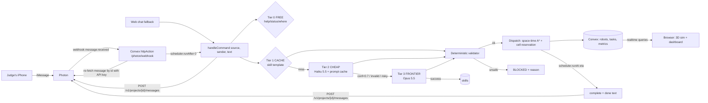

# SpecBot Text

**Text a robot fleet. Pay 90% less for its brain.**

Enter your iPhone number (or Apple ID email) on the site, get your iMessage number, and text a command like `move pallet from Dock A to Rack 3`. A robot carries it out live in a browser 3D warehouse, and SpecBot texts back which "brain" planned the task and what it cost compared with an all-frontier baseline.

- Live demo: https://specbot-text.vercel.app
- iMessage: register on the site. Photon assigns each phone a shared-line number (for example +1 628-997-9661) via the Photon 2.0 assignments API.

## Built tonight vs. before kickoff

Everything in this repo was written during the hackathon. Nothing existed before kickoff except the public libraries listed below.

## Tools

Vite + React + TypeScript, react-three-fiber + drei, Tailwind, Recharts · Convex (database, realtime queries, actions, scheduler, HTTP actions) · Anthropic Claude (`claude-haiku-5-5` cheap tier, `claude-opus-5-5` frontier tier) · Photon 2.0 REST API (iMessage: webhook destination in, `sendMessage` out, shared-line assignments for signup) · Firecrawl (robot spec scraping) · Vercel.

## Architecture



- **Server-authoritative sim.** Convex computes each robot's A* path with time-step cell reservation, so robots never share a cell or swap head-on. Paths are stored as timed waypoints, and every browser interpolates them against server time, so all viewers see the same fleet. A judge's text works even when no browser is open.
- **One handler.** The iMessage webhook, the web chat, and "Auto-run 20 tasks" all call the same `handleCommand`.
- **Learning.** A successful frontier plan (or a very confident cheap one) is parameterized into a skill template (`{{from}}`, `{{to}}`, `{{item}}`, `{{kg}}`, `{{robot}}`). The next similar text hits CACHE and costs $0.

## How costs are measured

- Every model call records the real `usage` from the Anthropic API response: input, output, cache-read and cache-write tokens.
- Cost = tokens × prices from [`shared/pricing.ts`](shared/pricing.ts). Cache reads are billed at 0.1× input and cache writes at 1.25× input.
- Retries and escalations are summed, so a CHEAP→FRONTIER task pays for both calls.
- **Baseline (measured, not assumed).** The first 3 robot tasks run on the frontier tier with full context, which is the "all-frontier" configuration. Their average real cost becomes the per-task baseline. Until 3 samples exist, the UI says "measuring".
- **% saved** = 1 − (actual spend ÷ (robot task count × measured baseline per task)). FREE commands (help/status) aren't counted as robot tasks.

## Run it

```bash
npm install
npx convex dev          # backend + codegen
npm run dev             # frontend
```

Convex env vars: `ANTHROPIC_API_KEY`, `PHOTON_PROJECT_ID`, `PHOTON_API_KEY` (project:read, project:write, platforms:write, messages:read), `PHOTON_WEBHOOK_SECRET`, `FIRECRAWL_API_KEY` (optional), `ADMIN_KEY`, `SITE_URL`, optional `PROFILE_URL`.
Frontend env: `VITE_CONVEX_URL`.

Webhook security: Photon 2.0 doesn't document its webhook signing scheme yet, so the webhook only takes the message id and re-fetches the message from Photon's API with our key. Forged deliveries can't inject commands. Deliveries are deduped on message id.

Admin: open `?admin=<ADMIN_KEY>` to show the Reset button. Refresh the robot profile with `npx convex run profile:refresh '{"adminKey":"..."}'`; it falls back to a bundled profile if scraping fails.
